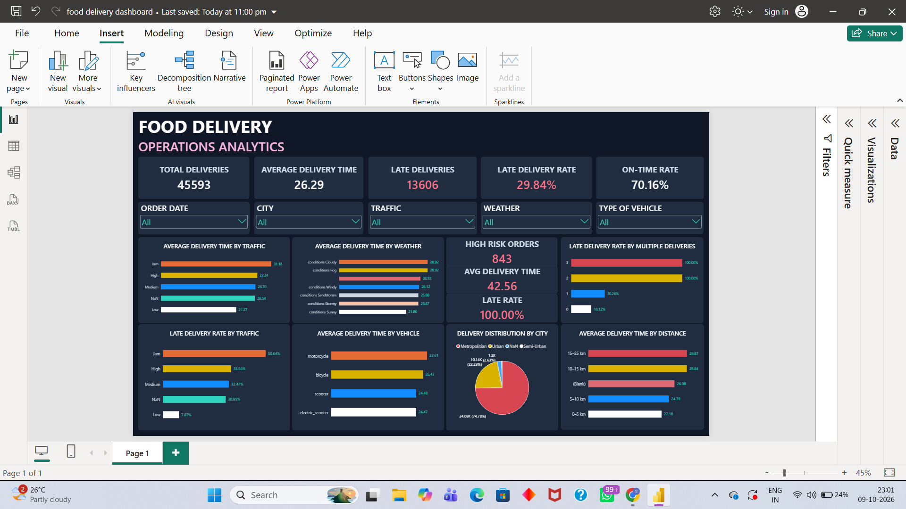

# Food Delivery Analysis

## Overview

An end-to-end data analytics project that investigates food delivery performance and identifies factors associated with longer delivery times and late deliveries. The project uses Python, SQL, statistical analysis, and Power BI to transform raw delivery data into actionable business insights.

**Business Question:** What factors are associated with delivery delays, and how can the company improve delivery performance?

## Dataset

* **Source:** [Food Delivery Dataset — Kaggle](https://www.kaggle.com/)
* **Dataset Contributor:** Gaurav Malik
* **Total Records:** 45,593 deliveries
* **Date Range:** February 11, 2022 – April 6, 2022
* **Target Metric:** Delivery time in minutes

The dataset includes order dates, delivery partner information, weather conditions, road traffic density, vehicle types, geographic coordinates, and delivery duration.

## Tools & Technologies

* **Python:** Pandas, NumPy
* **Data Visualization:** Matplotlib, Seaborn
* **SQL:** SQLite
* **Environment:** Jupyter Notebook
* **Dashboard:** Power BI, DAX
* **Version Control:** Git, GitHub

## Project Workflow

1. **Data Understanding & Cleaning** — Examined the dataset, validated data types, handled missing and invalid values, and prepared the cleaned dataset.
2. **Exploratory Data Analysis (EDA)** — Investigated delivery performance across traffic, weather, distance, vehicle type, city, and multiple deliveries.
3. **SQL Analysis** — Used SQLite queries to calculate key metrics and explore operational patterns.
4. **Statistical Analysis** — Applied statistical methods to examine relationships between delivery characteristics and delivery time.
5. **Advanced Analysis** — Investigated combined risk factors and identified high-risk delivery segments.
6. **Business Recommendations** — Translated analytical findings into practical operational recommendations.
7. **Power BI Dashboard** — Developed an interactive dashboard to monitor delivery KPIs and explore performance patterns.

## Key Findings

* **Delivery Performance:** Average delivery time was **26.29 minutes**.
* **Late Deliveries:** **29.84%** of deliveries took more than 30 minutes.
* **Traffic Impact:** Deliveries during traffic jams averaged **31.18 minutes**, compared with **21.27 minutes** under low traffic.
* **Weather Impact:** Cloudy and foggy conditions had the highest average delivery times, at approximately **28.92 minutes**.
* **Combined Risk Factors:** Orders during fog and traffic jams averaged **36.81 minutes**, with **76.08%** classified as late.
* **Multiple Deliveries:** Orders involving two or three deliveries averaged **40.45 minutes** and **47.82 minutes**, respectively.
* **High-Risk Segment:** The identified high-risk group contained **843 orders**, averaged **42.56 minutes**, and had a **100% late-delivery rate**.

## Power BI Dashboard

The interactive dashboard provides an overview of delivery performance through KPI cards, delivery status distribution, traffic and weather comparisons, vehicle analysis, distance bands, multiple-delivery analysis, city-level distribution, and high-risk delivery indicators.

Users can explore the results using slicers for order date, city, traffic density, weather conditions, and vehicle type.

### Dashboard Preview



## Business Recommendations

* Improve delivery planning during traffic jams and other high-delay conditions.
* Consider additional time buffers during foggy and cloudy weather.
* Review dispatch strategies for delivery partners handling multiple orders.
* Include delivery distance and operating conditions when estimating delivery times.
* Monitor high-risk orders and prioritize operational interventions.
* Track average delivery time and late-delivery rate through the Power BI dashboard.

## Repository Structure

```text
Food Delivery Analysis/
├── data/
│   ├── raw/
│   │   ├── train.csv
│   │   ├── test.csv
│   │   └── Sample_Submission.csv
│   └── cleaned/
│       └── food_delivery_cleaned.csv
├── notebooks/
│   ├── 01_data_understanding_cleaning.ipynb
│   ├── 02_exploratory_data_analysis.ipynb
│   ├── 03_sql_analysis.ipynb
│   ├── 04_statistical_analysis.ipynb
│   ├── 05_advanced_analysis.ipynb
│   └── 06_business_recommendations.ipynb
├── sql/
├── dashboard/
│   ├── food delivery dashboard.pbix
│   └── dashboard_screenshot.png
├── docs/
└── README.md
```

## How to Run

### Requirements

* Python 3
* Jupyter Notebook or Visual Studio Code with the Jupyter extension
* Power BI Desktop to open the dashboard

### Setup Instructions

1. Clone or download this repository.

2. Open the project folder in your preferred editor.

3. Install the required Python libraries:

   ```bash
   pip install pandas numpy matplotlib seaborn jupyter
   ```

4. Open the `notebooks` folder.

5. Run the notebooks in numerical order, beginning with `01_data_understanding_cleaning.ipynb`.

6. Open `dashboard/food delivery dashboard.pbix` in Power BI Desktop to explore the dashboard.

Keep the project folder structure unchanged so the notebooks' relative file paths continue to work.

## Limitations

* The dataset covers a limited period and may not represent delivery patterns across all seasons or current operating conditions.
* The analysis identifies associations, not necessarily causal relationships.
* Extreme or inaccurate geographic coordinates may affect distance calculations.
* Findings for categories with small sample sizes should be interpreted cautiously.

## Author

**Shreyas Bansod**

* GitHub: Add your GitHub profile link here.
* Project Repository: Add your repository link here.

---

*This project demonstrates practical data analytics skills in Python, SQL, exploratory analysis, statistical investigation, business recommendations, and Power BI dashboard development.*
